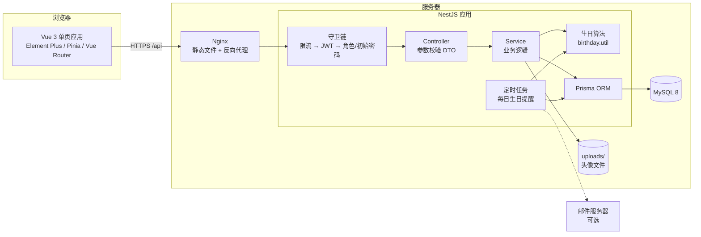
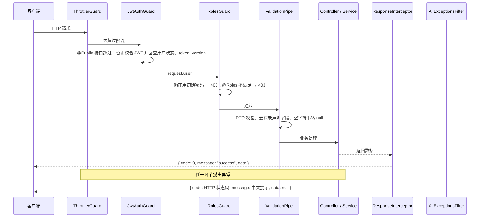
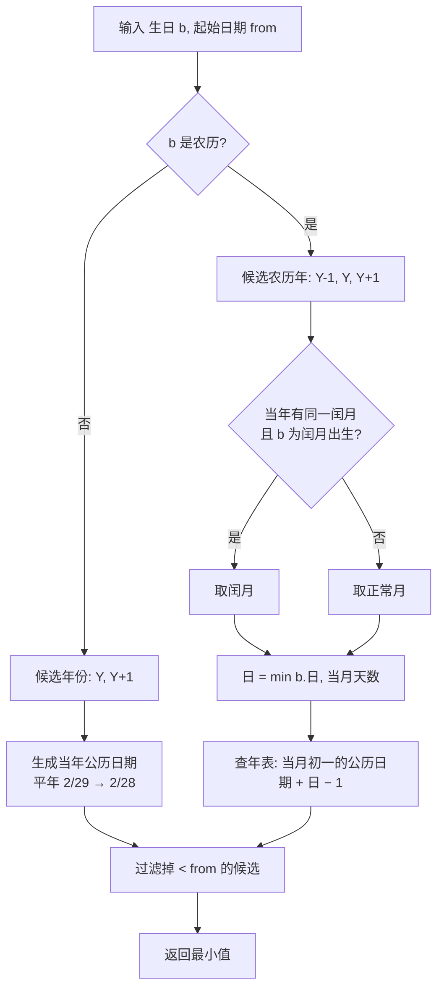
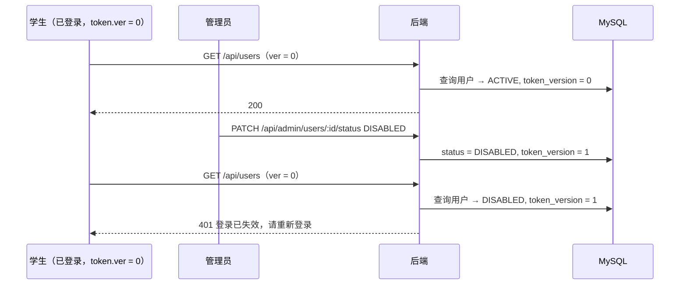
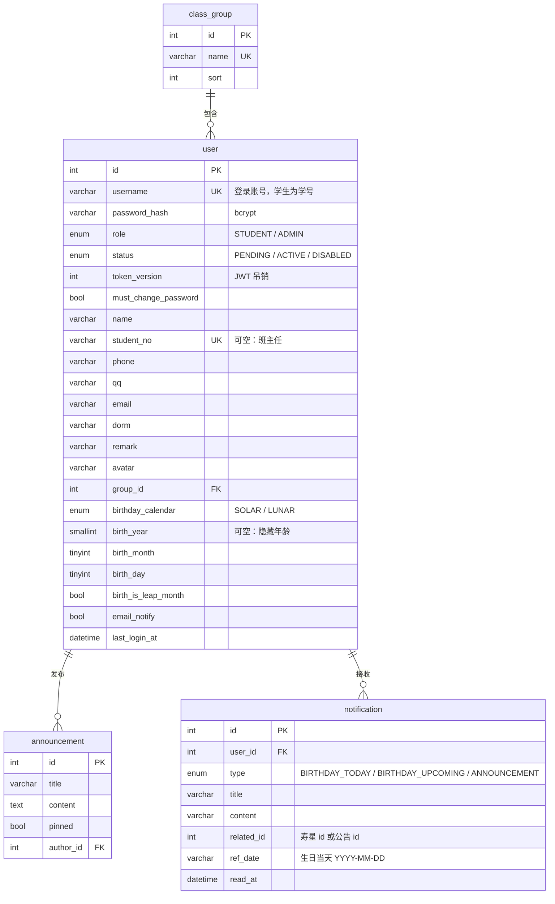
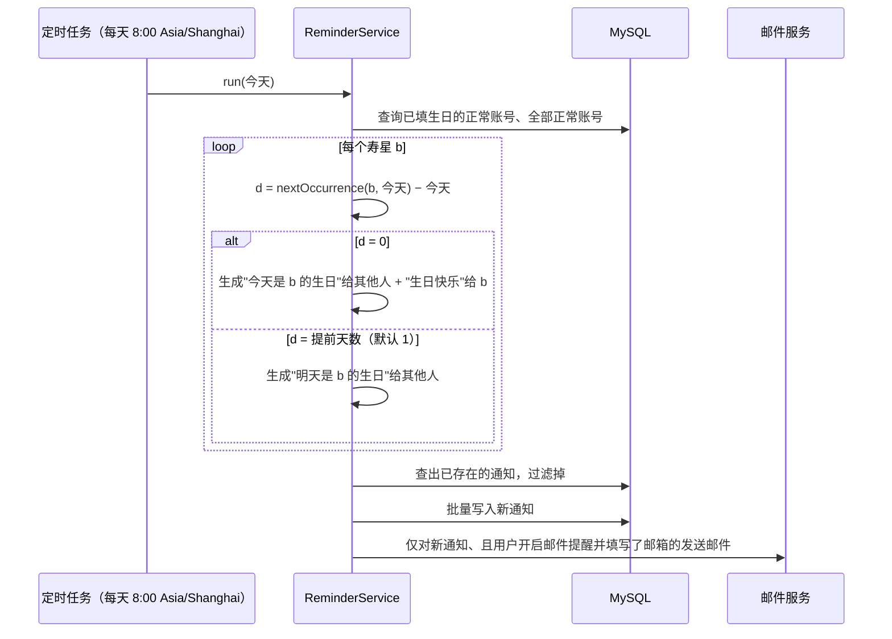

# 系统设计

## 1. 总体架构

系统采用前后端分离的 B/S 架构。前端为单页应用，通过 REST 接口与后端交互；后端按业务划分模块，经 Prisma ORM 访问 MySQL；定时任务运行在后端进程内。

### 1.1 技术选型

| 选型 | 理由 |
|---|---|
| NestJS | 模块化 + 依赖注入，Controller / Service / Module 分层清晰；守卫、管道、拦截器、过滤器覆盖鉴权、校验、统一响应、统一异常；官方提供 JWT、定时任务、Swagger、限流模块 |
| Prisma | 类型安全的查询，数据模型集中在 `schema.prisma`，迁移脚本自动生成并纳入版本管理 |
| MySQL 8 | 关系清晰、数据量小，utf8mb4 支持中文与 emoji |
| Vue 3 + Element Plus | 国内常用组件库，表单、表格、日历、抽屉等组件齐全，自带中文语言包 |
| lunar-javascript | 成熟的农历库，提供农历年、月、日与公历的互转 |

## 2. 后端模块

| 模块 | 职责 | 主要文件 |
|---|---|---|
| auth | 注册、登录、JWT 校验、修改密码 | `auth.service.ts`、`jwt.strategy.ts` |
| users | 通讯录查询、个人资料、头像上传 | `users.service.ts`、`profile.controller.ts`、`user.mapper.ts` |
| birthdays | 生日算法与生日查询接口 | `birthday.util.ts`、`birthdays.service.ts` |
| groups | 班级分组 | `groups.service.ts` |
| announcements | 班级公告，发布时通知全班 | `announcements.service.ts` |
| notifications | 站内通知、每日生日提醒任务、邮件 | `reminder.service.ts`、`notifications.service.ts`、`mail.service.ts` |
| admin | 用户管理与审核、统计、生日总览、Excel 导出 | `admin-users.service.ts`、`export.service.ts` |
| common | 统一响应、异常过滤、守卫、校验规则、日期工具、上传工具 | `common/` |

### 2.1 请求处理流程

统一异常过滤器还会把数据库唯一约束冲突（Prisma P2002）转换为 409"学号已存在"等提示，把记录不存在（P2025）转换为 404。

## 3. 生日核心算法

### 3.1 问题

所有生日相关功能都需要回答同一个问题："某人的下一次生日是哪天？"

- 近 7 天：今天到第 6 天之间过生日的人
- 本月：本月 1 日到月末之间过生日的人
- 倒计时：距下一次生日还有几天
- 每日提醒：今天 / 明天是否某人的生日

直接用"月、日"比较会在以下情况出错：

| 情况 | 例子 | 朴素做法的问题 |
|---|---|---|
| 跨年 | 12 月 28 日查"近 7 天"，1 月 2 日的生日 | 按月日比较 12-28 ≤ 01-02 不成立，漏掉 |
| 2 月 29 日 | 平年 | 当年不存在这一天，永远查不到 |
| 农历换算 | 农历八月十五 | 每年对应的公历日期不同，必须逐年换算 |
| 农历年滞后 | 公历 2027-01-20 是农历 2026 年腊月十三 | 只按公历年份换算农历，会得到 2028-01-09 |
| 农历小月 | 三十出生，当年该月只有 29 天 | 日期不存在，换算失败 |
| 农历闰月 | 闰六月出生，当年没有闰六月 | 日期不存在，换算失败 |

### 3.2 统一模型

生日存储为 `(历法, 出生年?, 月, 日, 是否闰月)`，出生年可为空（隐藏年龄）。定义：

> **nextOccurrence(b, from)**：生日 b 在公历日期 from 当天或之后的第一次出现，返回公历日期。

所有查询都归约为这一个函数：

| 查询 | 归约 |
|---|---|
| 区间 [s, e] 内是否过生日 | `nextOccurrence(b, s) ≤ e` |
| 近 N 天 | 区间 [今天, 今天 + N − 1] |
| 本月 | 区间 [本月 1 日, 本月末] |
| 倒计时 | `nextOccurrence(b, 今天) − 今天` |
| 今天生日 / 明天生日 | 倒计时 = 0 / = 1 |

区间归约的正确性：`nextOccurrence(b, s)` 是 ≥ s 的最早一次生日，区间内存在生日当且仅当这最早一次 ≤ e（区间长度小于一年时最多一次）。

### 3.3 计算方法

**公历**：设 from 所在公历年为 Y，候选为 Y 年和 Y+1 年的生日，取 ≥ from 的较小者。Y 年的生日若早于 from，则 Y+1 年的生日必然晚于 from，因此两个候选足够。2 月 29 日生日在平年取 2 月 28 日（不取 3 月 1 日，这样"本月生日"仍归在 2 月）。

**农历**：候选为农历 Y−1、Y、Y+1 年的生日，各自换算成公历后取 ≥ from 的最小值。

为什么这三个年份足够：农历年 L 从春节开始，春节总在公历 L 年 1 月 21 日至 2 月 20 日之间，所以农历 L 年覆盖的公历日期落在 [L 年 1 月 21 日, L+1 年 2 月 20 日]。

- 农历 Y+1 年最早从公历 Y+1 年 1 月 21 日开始，晚于 from，所以它的生日一定 ≥ from，候选集合中一定有解；Y+2 年及以后的生日都比它晚，不必考虑。
- 农历 Y−2 年最晚在公历 Y−1 年 2 月 20 日结束，早于 from，不必考虑。
- 农历 Y−1 年**必须**考虑：from 在公历 1~2 月且春节前时，仍处于农历 Y−1 年，该年的腊月生日就在眼前（见 3.1 表中"农历年滞后"一行）。

**农历规则**：

- 闰月出生：当年有同一个闰月则在闰月过，否则在同名的正常月份过；
- 三十出生：当年该月只有 29 天则在二十九过；
- 周岁：公历生日为"生日所在公历年 − 出生年"，农历生日为"生日所在农历年 − 出生农历年"。

### 3.4 复杂度与性能优化

每次查询对全班 n 人各调用一次 `nextOccurrence`，复杂度 O(n)。班级规模 n≈50，直接在内存中计算，不需要在数据库中预存"下次生日"字段（那样还需要每天更新）。

实现中发现一个性能问题：lunar-javascript 换算一个农历日期时要推算整个农历年的节气和朔日（单次约 0.5ms），而且它只缓存**最近一次**使用的年份。`nextOccurrence` 对每个人依次尝试 Y−1、Y、Y+1 三个年份，导致库内缓存每次都失效。

优化方法：按农历年缓存一张"年表"——该年每个月（含闰月）初一对应的公历日期和当月天数。任意农历日期的换算变为一次查表加一次日期加法：`公历 = 当月初一 + (日 − 1) 天`。同一年份只推算一次，缓存规模为"用到的年份数 × 13 个月"。

| 场景（50 个农历生日，一次查询） | 优化前 | 优化后 |
|---|---|---|
| 首次（需推算年表） | 约 120 ms | 约 14 ms |
| 后续 | 约 85 ms | 约 2.5 ms |

### 3.5 正确性验证

- 针对 3.1 表中每种边界情况编写了单元测试，期望值由农历库独立换算得到；
- **随机交叉验证**：另写一个思路完全不同的朴素算法作为参照——从 from 开始逐日向后扫描，把每天的公历日期转换为农历，检查是否命中生日（公历转农历方向，与被测实现的农历转公历方向相反，也不依赖"候选年份"的推理）。用固定种子生成 600 组随机生日（公历 / 农历、含闰月和三十）与 2020—2034 年的随机起始日期，两者结果必须完全一致；
- **变异测试**：人为在实现中引入错误（去掉 Y−1 候选、去掉 Y+1 候选、三十不回退、2 月 29 日不回退、年表日期偏移一天、忽略闰月），每一种都会被测试发现。

详见测试报告。

## 4. 安全设计

### 4.1 JWT 吊销：token_version

JWT 是无状态的，签发后在有效期内都能通过校验。若不处理，管理员禁用账号或用户修改密码后，已登录的旧会话仍然可用。

解决方法：用户表增加 `token_version` 字段，签发 JWT 时写入 `ver`。每次请求校验 JWT 后回查用户，要求账号状态为 ACTIVE 且 `ver` 与当前 `token_version` 一致。禁用、修改密码、重置密码时 `token_version + 1`，旧 token 立即失效。修改密码接口同时返回新 token，当前会话无需重新登录。

代价是每个请求多一次按主键查询，在班级规模下可以忽略；换来的是禁用即时生效，以及能在请求中拿到最新的角色和"必须改密码"状态。

### 4.2 其他措施

| 威胁 | 措施 |
|---|---|
| 密码泄露 | bcrypt（cost 10）加盐哈希；Prisma 客户端全局默认不查询 `password_hash` 字段，只有登录和改密码时显式取出 |
| 暴力破解 | 登录、注册每个 IP 每分钟最多 10 次（`AUTH_RATE_LIMIT`），其余接口每分钟 300 次 |
| 账号枚举 | "账号不存在"与"密码错误"返回相同提示 |
| 越权 | 全局守卫：默认需要登录，`@Public()` 显式放行；管理接口 `@Roles('ADMIN')`；学生只能修改本人资料，姓名、学号仅管理员可改；只能标记自己的通知为已读 |
| 弱初始密码 | 管理员新建或重置密码的账号置 `must_change_password`，修改密码前除"获取当前用户""修改密码"外的接口全部返回 403 |
| 恶意上传 | 按文件头（魔数）识别 JPG / PNG / WEBP，不信任扩展名和 Content-Type；大小上限 2MB；文件名使用随机 UUID；删除文件时校验路径必须位于上传目录内 |
| 非法输入 | class-validator 白名单校验，自动去除未声明字段；手机号、QQ、邮箱、学号、密码使用统一正则；生日按历法和出生年份校验日期是否真实存在 |
| 管理员误操作 | 不能禁用、删除自己，不能修改自己的角色；删除、禁用操作前端二次确认 |

## 5. 数据库设计

### 5.1 E-R 图

### 5.2 表结构

**user 用户表**（学生与管理员共用一张表，通讯录信息与账号信息一对一，不拆表以减少连接查询）

| 字段 | 类型 | 约束 | 说明 |
|---|---|---|---|
| id | INT | PK, 自增 | |
| username | VARCHAR(32) | 唯一 | 登录账号；学生注册时等于学号 |
| password_hash | VARCHAR(100) | 非空 | bcrypt 哈希 |
| role | ENUM | 默认 STUDENT | STUDENT / ADMIN |
| status | ENUM | 默认 PENDING，索引 | PENDING 待审核 / ACTIVE 正常 / DISABLED 禁用 |
| token_version | INT | 默认 0 | 禁用、改密、重置密码时 +1 |
| must_change_password | BOOLEAN | 默认 false | 管理员设置的初始密码需修改 |
| name | VARCHAR(20) | 非空，索引 | 姓名 |
| student_no | VARCHAR(20) | 唯一，可空 | 学号；班主任可为空 |
| phone / qq / email | VARCHAR | 可空 | 联系方式 |
| dorm | VARCHAR(50) | 可空 | 宿舍 |
| remark | VARCHAR(200) | 可空 | 备注 |
| avatar | VARCHAR(255) | 可空 | 头像 URL |
| group_id | INT | FK → class_group，删除时置空 | 所属小组 |
| birthday_calendar | ENUM | 可空 | SOLAR / LUNAR；为空表示未设置生日 |
| birth_year | SMALLINT | 可空 | 出生年，可不填以隐藏年龄 |
| birth_month / birth_day | TINYINT | 可空 | 生日月、日（农历时为农历月日） |
| birth_is_leap_month | BOOLEAN | 默认 false | 农历闰月出生 |
| email_notify | BOOLEAN | 默认 false | 接收生日提醒邮件 |
| last_login_at / created_at / updated_at | DATETIME(3) | | |

**class_group 小组表**：id、name（唯一）、sort、created_at。

**announcement 公告表**：id、title、content（TEXT）、pinned、author_id（FK → user，删除作者时置空，公告保留）、created_at、updated_at；索引 (pinned, created_at) 支持"置顶优先、按时间倒序"。

**notification 通知表**：id、user_id（FK → user，级联删除）、type、title、content、related_id、ref_date、read_at、created_at；唯一索引 (user_id, type, related_id, ref_date)，索引 (user_id, read_at) 支持未读计数。

### 5.3 设计要点

1. **生日拆成年 / 月 / 日整数而不是 DATE**：农历"二月三十"不是合法的公历日期，DATE 类型无法存储；同时出生年可以单独为空。
2. **通知去重靠唯一索引**：同一用户、同一类型、同一寿星、同一生日日期只能有一条通知，定时任务重复执行或手动补发都不会重复通知。`related_id`、`ref_date` 用默认值 0 和空字符串而不是 NULL，因为 MySQL 唯一索引允许多个 NULL，无法起到去重作用。
3. **外键删除策略**：删除小组 → 成员变为未分组（SET NULL）；删除用户 → 其通知级联删除，其发布的公告保留（作者置空），以其为寿星的生日通知在业务层一并删除。
4. **物理删除学生**：软删除会与学号唯一约束冲突（同一学号无法重新注册），班级场景下也不需要保留历史，因此采用物理删除并在前端二次确认。

## 6. 每日生日提醒

- 执行时间、提前天数通过环境变量配置；`REMINDER_CRON=off` 可关闭（测试环境使用）。
- 管理员可在"生日总览"页手动执行，并可指定日期，用于演示或服务器停机后补发。
- 未配置 SMTP 时邮件功能自动关闭；单封邮件发送失败只记录日志，不影响站内通知。

## 7. 前端设计

### 7.1 路由与权限

| 路由 | 页面 | 权限 |
|---|---|---|
| /login、/register | 登录、注册 | 公开 |
| / | 首页：今日寿星横幅、近 7 天生日、最新公告、管理员统计 | 登录 |
| /directory | 通讯录 | 登录 |
| /birthdays | 生日：近期 / 本月 / 月历 | 登录 |
| /announcements、/notifications | 公告、消息 | 登录 |
| /profile、/password | 个人中心、修改密码 | 登录 |
| /admin/users、/admin/groups、/admin/announcements、/admin/birthdays | 管理页面 | 管理员 |

全局路由守卫：无 token 跳转登录页（携带 redirect 参数）；首次进入时拉取当前用户；需修改初始密码时只能停留在修改密码页；非管理员访问管理页面时跳回首页。后端同样做了全部校验，前端守卫只用于改善体验。

### 7.2 请求封装

Axios 实例统一添加 `Authorization` 头并解包 `{ code, message, data }`，调用方直接拿到 `data`。401 时清除 token 并跳转登录页；403"请先修改初始密码"时跳转改密页；其他错误统一弹出后端返回的中文提示。

### 7.3 适配手机

学生主要用手机访问。宽度 ≤ 768px 时：侧边栏收起为抽屉菜单；通讯录由表格切换为卡片列表，电话可直接点击拨号；同学详情抽屉全屏显示；表单标签改为上下排列。
