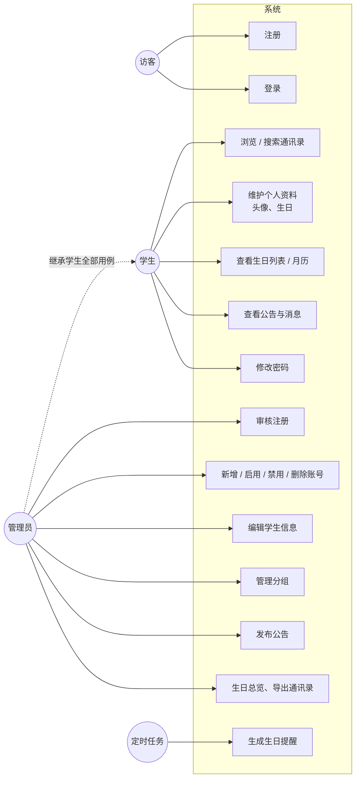
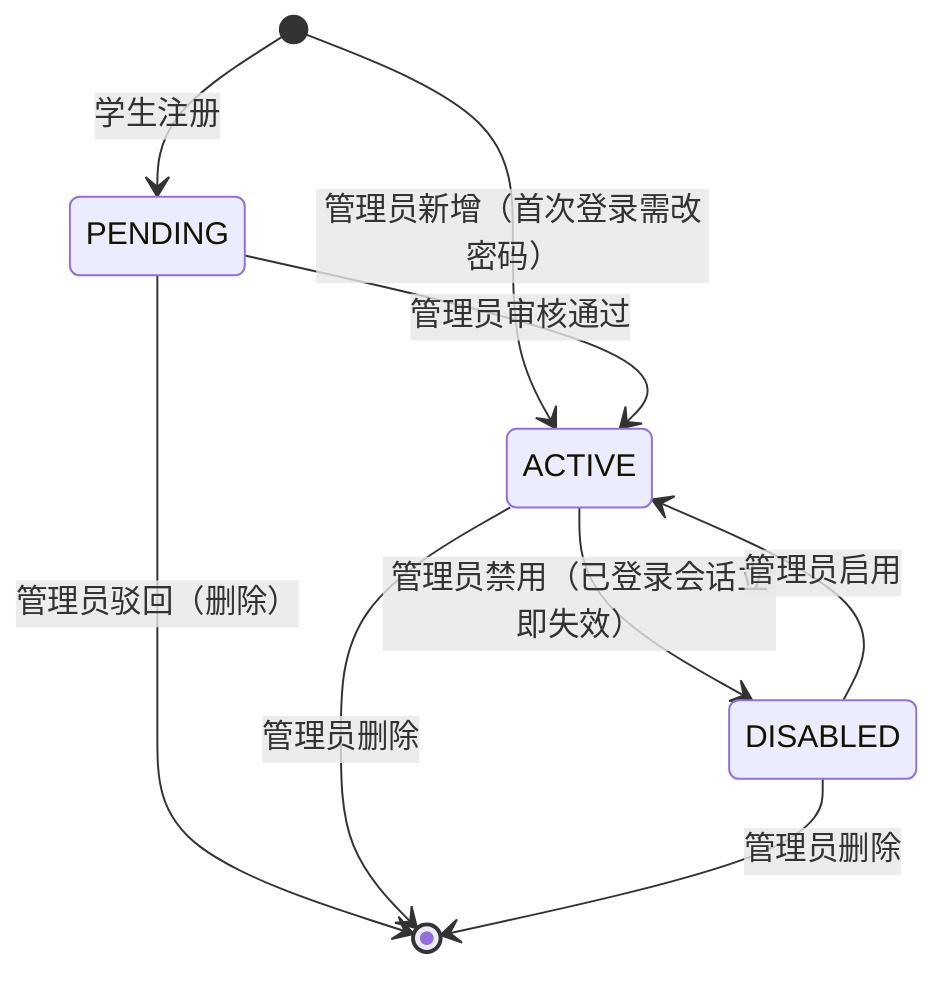

# 需求分析

## 1. 背景

班级同学的联系方式通常散落在 QQ 群、表格和个人手机里，信息更新不及时；同学生日更是依赖个人记忆，经常错过。本系统为单个班级提供统一维护的通讯录，并以"生日"为核心，在生日前和当天主动提醒全班。

## 2. 角色

| 角色 | 说明 |
|---|---|
| 访客 | 未登录，只能注册和登录 |
| 学生 | 审核通过的班级成员，可查看通讯录、维护本人资料、查看生日与公告 |
| 管理员 | 班长、班主任。拥有学生的全部功能，另可审核账号、维护通讯录、管理分组与公告。班主任可以没有学号 |

## 3. 功能需求

### 3.1 学生端（原始需求）

| 编号 | 功能 | 说明 |
|---|---|---|
| S1 | 注册、登录 | 学号 + 密码注册，学号即登录账号；JWT 认证 |
| S2 | 查看班级通讯录 | 浏览全班同学姓名、学号、电话、QQ、宿舍、备注 |
| S3 | 个人信息维护 | 修改本人资料、上传头像、设置生日 |
| S4 | 生日列表 | 近期（近 7 天）生日、本月生日 |
| S5 | 简单搜索 | 按姓名、学号搜索同学 |
| S6 | 修改登录密码 | 校验原密码 |

### 3.2 管理员端（原始需求）

| 编号 | 功能 | 说明 |
|---|---|---|
| A1 | 用户管理 | 新增学生账号、启用 / 禁用账号、删除学生信息 |
| A2 | 通讯录管理 | 审核 / 编辑学生信息，防止乱填 |
| A3 | 班级分类（可选） | 划分小组 |
| A4 | 生日记录与导出（可选） | 查看全部生日、导出通讯录 |
| A5 | 公告管理（加分项） | 发布班级通知公告 |

### 3.3 扩展功能

| 编号 | 功能 | 说明 |
|---|---|---|
| E1 | 主动生日提醒 | 每天定时生成站内通知：当天通知全班并祝福寿星本人，提前 1 天预告；可选邮件 |
| E2 | 农历生日 | 支持按农历过生日，每年自动换算为对应的公历日期参与查询和提醒 |
| E3 | 生日月历 | 以日历形式展示某月所有同学的生日 |
| E4 | 消息通知 | 生日提醒、新公告进入个人消息列表，未读角标提示 |

## 4. 对原始需求的补充与修正

原始需求中有几处若按字面实现会产生问题，设计时做了如下处理：

1. **"生日提醒"在原始需求中只有"查看生日列表"**。查看列表是被动查询，用户不打开系统就不会知道谁过生日，与平台名称中的"提醒"不符。因此增加了扩展功能 E1：定时任务每天主动生成通知。
2. **开放注册会泄露隐私**。通讯录包含全班电话和宿舍，如果任何人注册即可浏览，外人也能获取这些信息。因此注册后账号处于"待审核"状态，管理员核对姓名和学号后才能登录；这同时落实了 A2 中的"审核"。
3. **"审核 / 编辑学生信息"的粒度**。若每次修改资料都需审核，会给管理员带来大量工作。最终方案：注册需要审核；审核依据的姓名、学号只能由管理员修改；联系方式、宿舍、生日等由学生自行修改、立即生效，管理员可随时纠正。"防止乱填"另由字段格式校验保证（手机号、QQ、邮箱、学号、生日合法性）。
4. **JWT 无法撤销**。JWT 签发后在有效期内一直有效，若不做处理，"禁用账号"和"修改密码"都不会让已登录的会话失效。设计中为用户增加 `token_version` 字段，详见系统设计 4.1 节。
5. **生日计算的边界情况**。"近 7 天""本月"看似简单，但存在跨年、2 月 29 日、农历换算等边界，是本系统的核心难点，详见系统设计第 3 节。
6. **班主任不是学生**。班主任没有学号，因此登录账号与学号分为两个字段：学生注册时账号即学号，班主任账号由初始化脚本或管理员创建。

## 5. 非功能需求

| 类别 | 要求 |
|---|---|
| 安全 | 密码 bcrypt 加盐哈希存储；登录 / 注册接口限流防暴力破解；登录失败不区分"账号不存在"与"密码错误"；接口按角色鉴权；上传文件按文件头识别类型 |
| 隐私 | 通讯录仅对审核通过的班级成员可见；出生年份可不填写以隐藏年龄 |
| 可用性 | 全中文界面与错误提示；手机浏览器可正常使用（窄屏布局、卡片视图、点击拨号） |
| 性能 | 面向几十人规模的班级，常用接口响应时间在 100ms 以内 |
| 可维护性 | 前后端分离、分层架构；统一的响应格式和错误处理；核心算法有单元测试，主要业务流程有 e2e 测试 |

## 6. 用例图

## 7. 业务流程：账号生命周期

